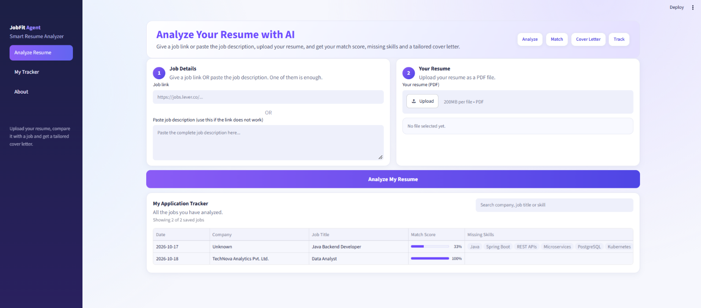

# JobFit Agent — AI-Powered Resume Analyzer

JobFit Agent helps job seekers understand how well their resumes match a job description. Upload your resume, provide a job posting, and let the AI agent analyze your skills, calculate a match score, identify skill gaps, and generate a tailored cover letter.

Built with Python, the OpenAI Agents SDK, FastAPI, and Streamlit.

## Application Preview



## Features

- **Resume Upload:** Upload your resume in PDF format.
- **Job Description Analysis:** Provide a job URL or paste the description directly.
- **Match Score:** Evaluate how well your resume matches the job requirements.
- **Skill Gap Analysis:** View matched skills and skills missing from your resume.
- **Tailored Cover Letter:** Generate a cover letter based on the job and your resume.
- **Application Tracker:** Save and review previously analyzed job applications.
- **Tracker Search:** Search saved jobs by company, job title, or skill.
- **REST API:** Access the application through its FastAPI backend.
- **Modern UI:** Use a clean, responsive Streamlit interface.

## Technology Stack

| Technology | Purpose |
|---|---|
| Python | Core application development |
| OpenAI Agents SDK | AI agent workflow |
| FastAPI | Backend API |
| Streamlit | User interface |
| Pydantic | Data validation |
| Git and GitHub | Version control |

## How It Works

1. Upload your resume as a PDF.
2. Enter a job URL or paste the job description.
3. Run the analysis.
4. Review your match score and matched skills.
5. Identify missing skills and potential improvement areas.
6. Generate and download a tailored cover letter.
7. Review the analyzed job in your application tracker.

## Project Structure

```text
jobfit-ai-agent/
├── app.py
├── agent.py
├── api.py
├── tools.py
├── requirements.txt
├── tracker.json
├── sample/
├── screenshots/
│   └── jobfit-dashboard.png
└── docs/
    └── jobfit-ui-reference.png
```

## Prerequisites

- Python 3.12
- An OpenAI API key with API access and available quota
- Git

## Installation

### 1. Clone the repository

```bash
git clone https://github.com/santhoshreddy0047-lgtm/jobfit-ai-agent.git
cd jobfit-ai-agent
```

### 2. Create a virtual environment

**Windows PowerShell**

```powershell
py -3.12 -m venv .venv
.\.venv\Scripts\Activate.ps1
```

**macOS / Linux**

```bash
python3.12 -m venv .venv
source .venv/bin/activate
```

### 3. Install dependencies

```bash
python -m pip install -r requirements.txt
```

### 4. Configure your OpenAI API key

Create a `.env` file in the project root:

```env
OPENAI_API_KEY=your_actual_openai_api_key
```

Replace the placeholder with your own API key.

**Security:** Never commit your `.env` file or expose your API key in source code, screenshots, or logs.

## Run the Application

Start the FastAPI backend in the first terminal:

```bash
uvicorn api:app --reload
```

Backend URL:

http://127.0.0.1:8000

Interactive API documentation:

http://127.0.0.1:8000/docs

Start the Streamlit frontend in a second terminal:

```bash
streamlit run app.py
```

Open the application:

http://localhost:8501

## Testing

The project includes automated checks for UI behavior, input validation, tracker functionality, and match-score consistency.

Run the tracker score regression test, if included in your checkout:

```bash
python test_tracker_score.py
```

The tracker score fix ensures that the score calculated during skill comparison is used when saving the job, keeping the saved score consistent with the analysis response.

Run the project's available tests to verify the current implementation.

## Security and Data

- Keep API keys in environment variables.
- Do not commit `.env` or `.venv/`.
- Avoid publishing resumes containing personal information.
- Review sample files before making the repository public.
- Keep tracker data free of sensitive personal information.

## Future Improvements

- Enhanced mobile experience.
- More comprehensive automated testing.
- Improved job posting extraction.
- Additional application tracking features.

## Author

**Santosh Reddy**

GitHub: [santhoshreddy0047-lgtm](https://github.com/santhoshreddy0047-lgtm)

## License

No license has been specified yet.